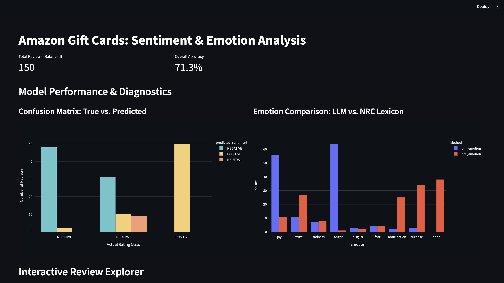

# Amazon Gift Cards: Sentiment & Emotion Analysis

For this project, I built an end-to-end pipeline to classify the sentiment (Positive, Neutral, Negative) and primary emotion of Amazon gift card reviews[cite: 1]. I used a local LLM for the main predictions and compared its emotion outputs against a traditional NRC lexicon word list[cite: 1]. Everything feeds into a Streamlit dashboard[cite: 1].

**Data Source:** 
I used the 2023 "Gift Cards" dataset from the McAuley Lab at UC San Diego: [https://amazon-reviews-2023.github.io](https://amazon-reviews-2023.github.io)[cite: 1].

## Dashboard Interface

## Findings & Analysis

### 1. The Reality of Balanced Sampling
The raw gift card data is incredibly lopsided—almost everything is 4 or 5 stars[cite: 1]. If I had just pulled a sequential sample, the model would look artificially accurate just by guessing "Positive" every time[cite: 1]. By forcing a strictly balanced sample (50 reviews per class, 150 total) using a fixed random seed, I got a real look at how the model actually performs[cite: 1, 4]. The balanced run showed a true overall accuracy of 71.3%[cite: 4]. It does well at the extremes but struggles with the middle ground.

### 2. Where the Model Fails (Confusion Matrix)
Looking at the confusion matrix, the model's mistakes are almost entirely concentrated on 3-star (Neutral) reviews[cite: 4]. 
* It nailed nearly all 50 Positive reviews and about 48 of the Negative ones[cite: 4]. 
* However, it completely collapsed on the Neutral class[cite: 4]. Instead of recognizing 3-star reviews as Neutral, the model dumped about 31 of them into Negative and pushed another 10 into Positive[cite: 4]. Only around 9 True Neutral reviews were actually classified correctly[cite: 4]. 

### 3. LLM vs. Word List Emotion Scoring
The two methods handled emotion completely differently:
* **LLM (Context):** The LLM heavily skewed toward `anger` (around 65 reviews) and `joy` (around 55 reviews)[cite: 4]. It reads the overall context, so it essentially translates "bad experience" to anger and "good experience" to joy, ignoring nuanced emotions like fear or disgust[cite: 4].
* **NRC Lexicon (Literal):** The word list had a much flatter distribution[cite: 4]. Its biggest bucket was actually `none` (around 38 reviews), meaning the text didn't contain any exact matches to the dictionary[cite: 4]. When it did match, it leaned toward `surprise`, `trust`, and `anticipation`[cite: 4]. Since it only looks for specific words, it entirely misses the tone of a review if the exact vocabulary isn't there.

### 4. Technical Hurdles
I ran into a few specific roadblocks while building this out:
* **Environment lockouts:** My Mac's global Python environment blocked standard `pip` installs (an `externally-managed-environment` error). I had to set up an isolated `.venv` virtual environment to get `requests` and `streamlit` installed.
* **Dead links:** The automated download script for the NRC word list failed with a 404 error since academic hosting links change often. I worked around this by downloading the ZIP manually and using Python's `zipfile` library to extract the text file directly in the code.
* **Directory pathing:** Early on, the terminal kept throwing `FileNotFoundError`s because it was operating in the root directory instead of the project folder. I fixed this by using absolute paths in the scripts so they always found the right files regardless of where the terminal was pointed.